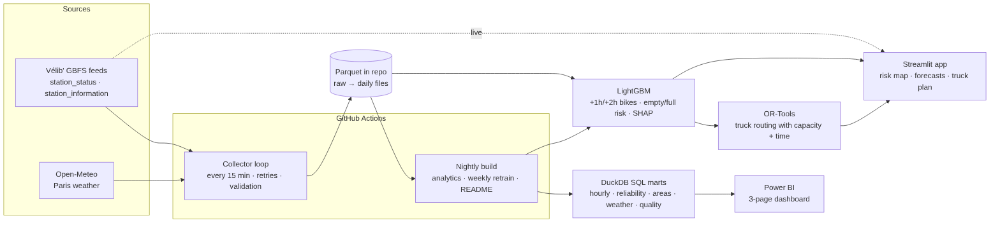
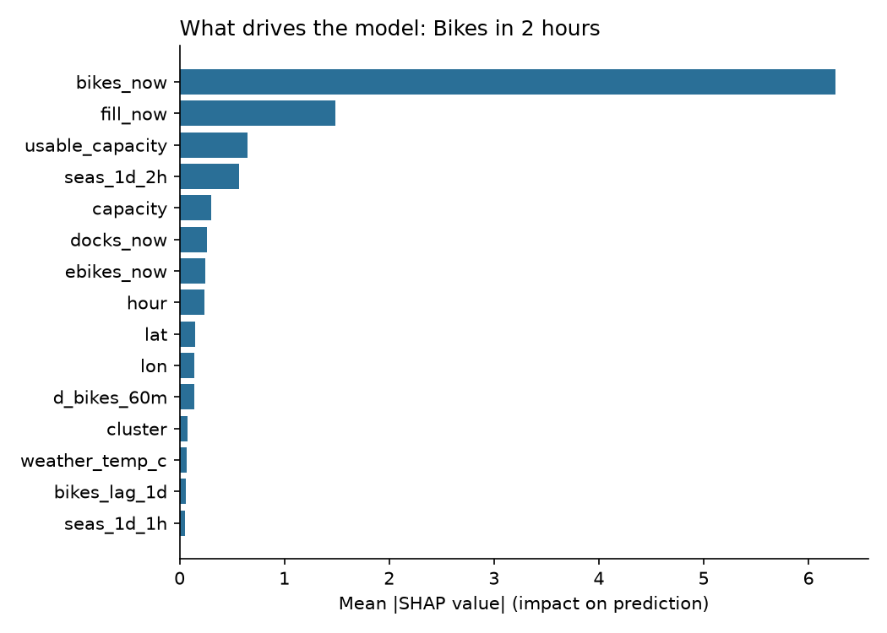
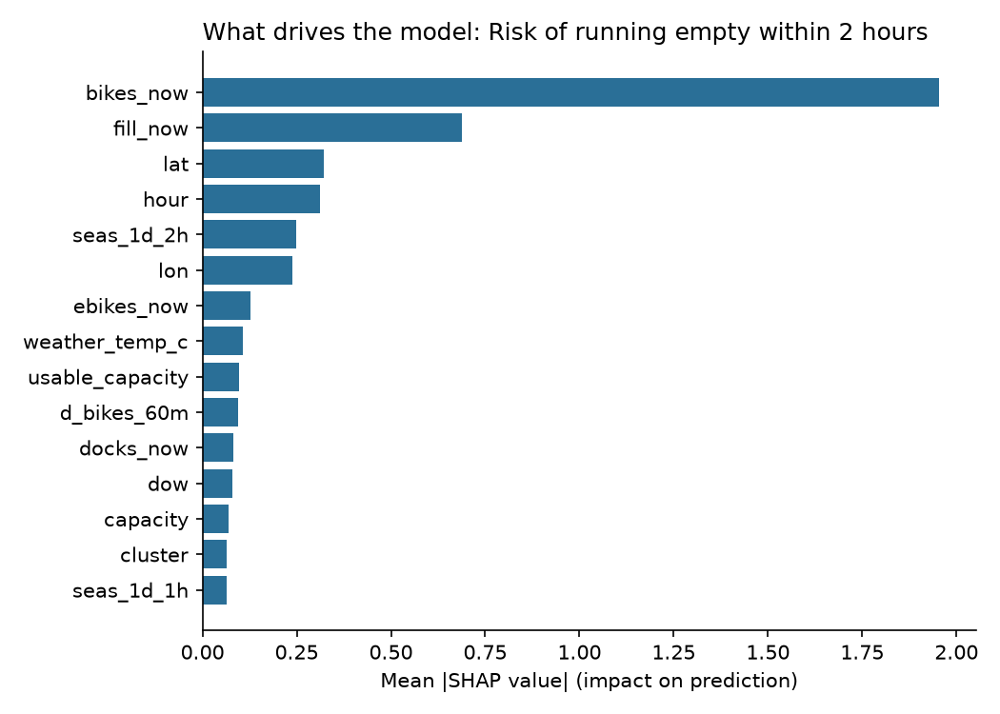

# 🚲 Paris Vélib' Operations Intelligence

[](https://github.com/thirurishi/paris-velib-operations-intelligence/actions/workflows/collect.yml)
[](https://github.com/thirurishi/paris-velib-operations-intelligence/actions/workflows/build.yml)
[](https://github.com/thirurishi/paris-velib-operations-intelligence/actions/workflows/ci.yml)


[](https://velib-ops-thiru.streamlit.app/)

> **I built a system that collects live Vélib' data every 15 minutes, predicts which stations will be empty or full in the next 2 hours, and tells rebalancing trucks where to go first.**

**🔗 Live app: [velib-ops-thiru.streamlit.app](https://velib-ops-thiru.streamlit.app/)** · **📊 Power BI:** [`powerbi/`](powerbi/)

**Data collected so far:**
<!-- AUTO:STATUS -->
**7 days** collected (2026-11-05 → 2026-11-11) · **483 snapshots** · ~**723,051** station records · average coverage **90%** of 15-minute slots · 1,497 stations. _Last refreshed 2026-11-11 11:27 UTC._
<!-- /AUTO:STATUS -->

---

## Executive summary

**Problem.** Vélib' Métropole runs ~1,500 stations across Paris and 55 nearby towns. At rush hour, residential
stations run out of bikes and business-district stations fill up, so riders can't take or return a bike.
The operator moves bikes with a small truck fleet, so the real question is:
*which stations will have a problem soon, and in what order should the trucks visit them?*

**Key findings** (computed automatically from the collected data, refreshed nightly):
<!-- AUTO:INSIGHTS -->
1. **Shortages are concentrated.** Across 1,497 stations the network logs **1,293.5 empty-station hours per day**; the worst 20 stations cause **12.5%** of them.
2. **Rush hours drive the problem.** On weekdays the share of empty stations peaks at **13:00** (8.5% of stations, vs 2.4% at the quietest hour); full stations peak at **11:00** (3.9%).
3. **Morning commute moves bikes one way.** Between 5:00 and 9:00 on weekdays, stations drain in Asnières-sur-Seine (-29%), Vanves (-18%), Lilas (-18%) and fill up in Paris 8e (+24%), Paris 2e (+21%), Paris 6e (+17%) (change in average fill ratio).
4. **Rain cuts usage.** Weekday daytime activity is **+3%** in rainy slots compared with dry ones.

Full list of the worst stations: [`reports/insights.md`](reports/insights.md).
<!-- /AUTO:INSIGHTS -->

**Recommendation.** Dispatch trucks from the 2-hour risk forecast instead of from current counts: the
forecast flags stations *before* they empty, and OR-Tools routing serves the most valuable stops within
each truck's capacity and shift. A small set of chronic problem stations deserves structural fixes
(more docks, or a standing morning delivery) rather than daily truck visits.

**Estimated impact.** For every plan, the app reports the expected empty/full station-hours prevented in the
next 2 hours and compares OR-Tools against *no action*, a *greedy* dispatcher and visiting the same risky
stations in a *random order* (see the "Rebalancing plan" tab).

---

## Architecture



| Step | Tool | What it does |
|---|---|---|
| Collect | Python, GitHub Actions | Loop job collects every 15 min, commits Parquet, restarts itself every ~5.5 h |
| Store | Parquet (one file per day) | ~4 MB/day, read by pandas, DuckDB and Power BI |
| Transform | DuckDB SQL ([`sql/`](sql/)) | Raw snapshots → hourly, reliability, area, weather and data-quality tables |
| Analyse | Power BI | 3-page dashboard ([build guide](powerbi/README.md)) |
| Forecast | LightGBM, SHAP | Bikes at +1h/+2h and empty/full risk within 2h, explained with SHAP |
| Optimise | Google OR-Tools | Truck routes with capacity, shift length and optional stops |
| Serve | Streamlit + pydeck | Live risk map, station forecasts, truck plan |
| Quality | pytest, ruff, CI, Docker | 26 tests, lint on every push, containerised app |

## Data

| Data | Source | Collection |
|---|---|---|
| Station status (bikes, e-bikes, docks, flags) | [Vélib' Métropole GBFS](https://opendata.paris.fr/explore/dataset/velib-disponibilite-en-temps-reel/) `station_status.json` | every 15 min |
| Station list (name, lat/lon, capacity) | Vélib' GBFS `station_information.json` | daily |
| Weather (temperature, rain, wind) | [Open-Meteo](https://open-meteo.com/) | every 15 min |
| Commune boundaries | [france-geojson](https://github.com/gregoiredavid/france-geojson) (IGN/INSEE) | static |
| Holidays | `holidays` (France) + Paris Zone C school calendar 2026–27 | static |

Every row is validated (no negative counts, bikes + docks ≤ capacity, mechanical + e-bikes = total) and flagged
rather than silently dropped. Data health is tracked in `mart_data_quality` and by `python -m velib.check_data`.

## Forecasting

- **Target:** bikes available at **+1h** and **+2h**, plus the probability of hitting **0 bikes** or **0 docks** within 2h.
- **Features:** current state, momentum (15/30/60 min), same time yesterday / last week (also at the target time),
  hour, weekday, public & school holidays, weather, capacity, location, spatial cluster.
- **Validation:** time-based split (last 7 days = test), never random. Baselines: persistence, seasonal, and a
  "≤ 2 bikes now" alert rule. Retrained every Monday by the nightly build.

<!-- AUTO:MODEL -->
Test period: 2026-11-08 → 2026-11-09 (time-based split).

| Forecast | Persistence MAE | Seasonal MAE | **LightGBM MAE** | Improvement vs persistence |
|---|---|---|---|---|
| Bikes in +1h | 1.54 | 6.05 | **1.58** | -2% |
| Bikes in +2h | 2.40 | 6.10 | **2.46** | -3% |

| 2-hour alert | Rule (≤ 2 now) precision / recall | **LightGBM precision / recall** |
|---|---|---|
| Station runs empty | 0.49 / 0.79 | **0.76 / 0.56** |
| Station gets full | 0.48 / 0.74 | **0.75 / 0.54** |

**What drives the predictions (SHAP):**




Details: [`reports/model_results.md`](reports/model_results.md).
<!-- /AUTO:MODEL -->

## Rebalancing optimisation

1. **Tasks:** stations with ≥ 30% empty risk get a drop-off (up to 40% fill); ≥ 30% full risk get a pick-up
   (down to 60% fill); healthy stations with spare bikes near the drop-offs can donate.
2. **Value of a stop** = risk probability × 1 hour (expected problem-hours prevented).
3. **OR-Tools** vehicle routing: trucks (default 3 × 20 bikes) start at a depot with bikes on board; the load must
   stay between 0 and capacity; each route must fit the 2-hour window (travel at 15 km/h × 1.35 street factor,
   4 min per stop + 30 s per bike). Stops are optional; skipping one costs its value, so the solver picks the best set.
4. **Benchmarks:** no action, random order, greedy (best value per minute).

## Run it locally

```bash
python -m venv .venv
source .venv/bin/activate                 # Windows: .venv\Scripts\activate
pip install -r requirements.txt
export PYTHONPATH=src                     # Windows PowerShell: $env:PYTHONPATH="src"

python -m velib.collect                   # collect one snapshot now
python -m velib.check_data                # data-quality report
python -m velib.analytics                 # DuckDB marts + reports/insights.md
python -m velib.train                     # train + evaluate (needs ≥ 3 days of data)
python -m velib.predict                   # riskiest stations right now
python -m velib.optimise                  # truck plan + strategy comparison
streamlit run app/streamlit_app.py        # the app
pytest                                    # 26 tests
```

No data yet? `python -m velib.simulate --days 35 --out data_synthetic` creates a **synthetic** network to try
everything (`VELIB_DATA_DIR=data_synthetic python -m velib.analytics`). It is clearly separated and never mixed with real data.

Docker: `docker build -t velib-ops . && docker run -p 8501:8501 velib-ops`

## Repository structure

```
.github/workflows/  collect.yml (15-min loop) · build.yml (nightly) · ci.yml (tests)
src/velib/          collect · storage · check_data · geo · analytics · features · train · predict · optimise · report · simulate
sql/                DuckDB models (staging + 6 marts)
app/                Streamlit app
notebooks/          01_eda · 02_baselines · 03_model_shap
powerbi/            build guide, DAX measures, theme (+ your .pbix)
models/  reports/   trained models and auto-generated results
data/               raw/ · daily/ · stations/ · reference/
tests/              pytest suite
```

## Limitations & next steps

- **No trip data:** Vélib' publishes station counts only, so demand is inferred from count changes (a lower bound).
- **Truck model is simplified:** straight-line distances, one assumed depot, no traffic or driver breaks.
- **Station-level operator actions are invisible:** real trucks already rebalance, which hides part of the demand.
- **Next:** probabilistic forecasts (quantiles), event calendar (strikes, marathons), road-network travel times
  (OSRM), and a feedback loop measuring whether served stations actually stayed available.

## Licences & credits

Code: MIT. Vélib' data © Smovengo / Syndicat Autolib' Vélib' Métropole, [ODbL](https://opendatacommons.org/licenses/odbl/).
Weather: Open-Meteo.com (CC BY 4.0). Commune boundaries: IGN / INSEE via france-geojson.

## About

Built by **Thirumurugan Kumar**, MSc Data Science & Analytics (EPITA, Paris), looking for a Data / Business
Operations internship from January 2027. GitHub [@thirurishi](https://github.com/thirurishi).
