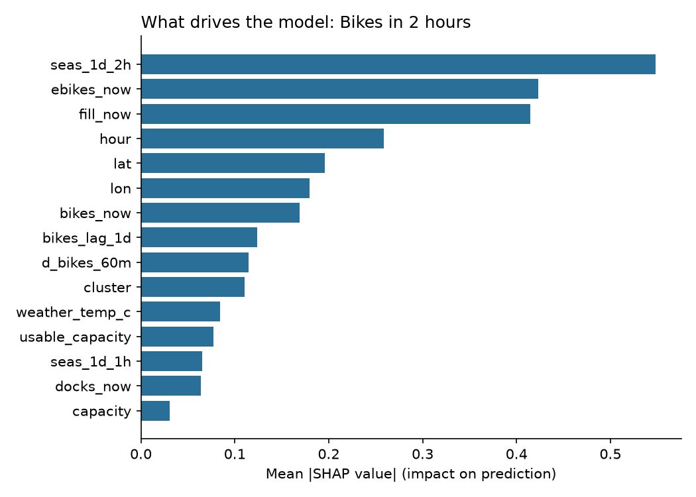
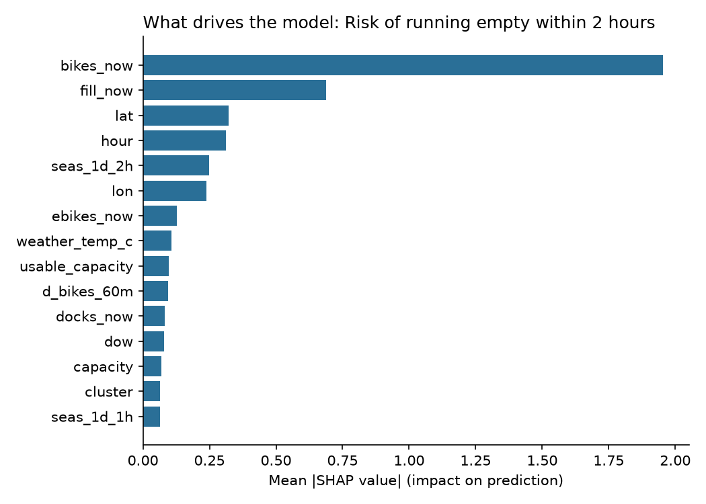

# Forecasting results

_Trained 2026-11-09T15:19:20+00:00 UTC on data from 2026-11-05 23:00:00+00:00 to 2026-11-08 10:30:00+00:00; tested on 2026-11-08 12:45:00+00:00 → 2026-11-09 15:15:00+00:00 (160,122 station-slots). Time-based split, never random._

> ⚠️ Fewer than 14 days of data: test set is the last 30% of the period. Results are preliminary.

## Bikes available in 1h / 2h (MAE, lower is better)

| Horizon | Method | MAE (bikes) | vs persistence |
|---|---|---|---|
| +1h | Persistence (same as now) | 1.54 | +0.0% |
| +1h | Seasonal (last week, else yesterday) | 6.05 | +291.8% |
| +1h | LightGBM | 1.58 | +2.2% |
| +2h | Persistence (same as now) | 2.40 | +0.0% |
| +2h | Seasonal (last week, else yesterday) | 6.10 | +154.5% |
| +2h | LightGBM | 2.46 | +2.7% |

## Shortage alerts within 2h

| Event | Method | Base rate | Precision | Recall | Avg precision | Alerts / slot |
|---|---|---|---|---|---|---|
| empty_2h | Rule: <= 2 now | 10.8% | 0.49 | 0.79 | 0.411 | 259.9 |
| empty_2h | LightGBM | 10.8% | 0.76 | 0.56 | 0.73 | 117.8 |
| full_2h | Rule: <= 2 now | 6.1% | 0.48 | 0.74 | 0.375 | 140.7 |
| full_2h | LightGBM | 6.1% | 0.75 | 0.54 | 0.694 | 66.0 |

## What drives the predictions

