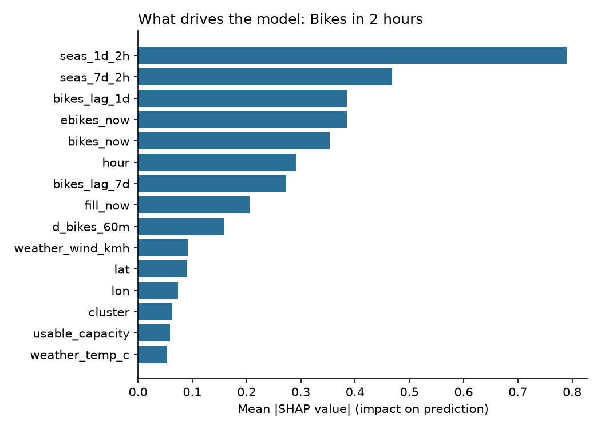
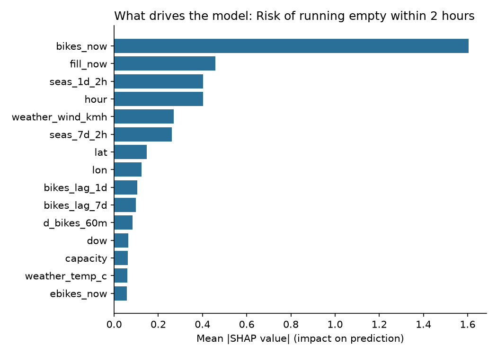

# Forecasting results

_Trained 2026-11-16T12:05:34+00:00 UTC on data from 2026-11-05 23:00:00+00:00 to 2026-11-13 05:30:00+00:00; tested on 2026-11-13 07:45:00+00:00 → 2026-11-16 11:45:00+00:00 (385,984 station-slots). Time-based split, never random._

> ⚠️ Fewer than 14 days of data: test set is the last 30% of the period. Results are preliminary.

## Bikes available in 1h / 2h (MAE, lower is better)

| Horizon | Method | MAE (bikes) | vs persistence |
|---|---|---|---|
| +1h | Persistence (same as now) | 1.68 | +0.0% |
| +1h | Seasonal (last week, else yesterday) | 6.10 | +264.1% |
| +1h | LightGBM | 1.61 | -3.7% |
| +2h | Persistence (same as now) | 2.51 | +0.0% |
| +2h | Seasonal (last week, else yesterday) | 6.10 | +143.0% |
| +2h | LightGBM | 2.31 | -7.9% |

## Shortage alerts within 2h

| Event | Method | Base rate | Precision | Recall | Avg precision | Alerts / slot |
|---|---|---|---|---|---|---|
| empty_2h | Rule: <= 2 now | 10.6% | 0.48 | 0.77 | 0.396 | 250.6 |
| empty_2h | LightGBM | 10.6% | 0.76 | 0.55 | 0.746 | 113.4 |
| full_2h | Rule: <= 2 now | 6.0% | 0.50 | 0.70 | 0.368 | 123.8 |
| full_2h | LightGBM | 6.0% | 0.81 | 0.48 | 0.723 | 52.9 |

## What drives the predictions

